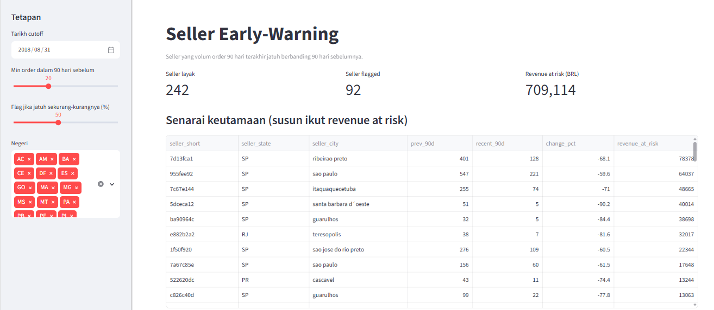
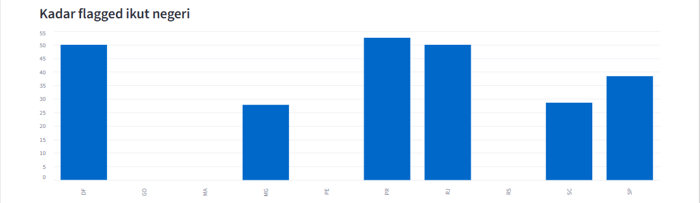
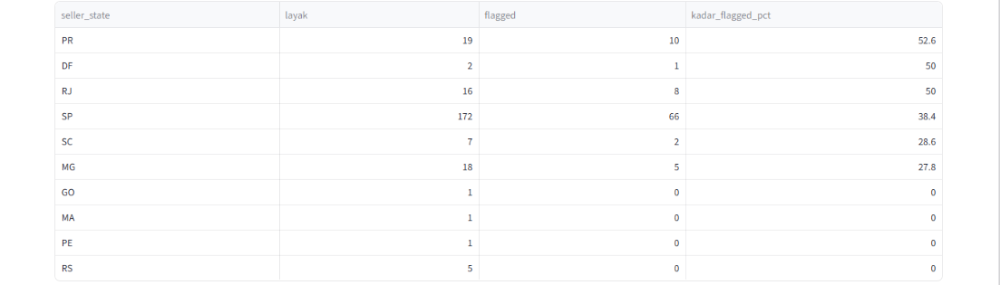

# Seller Early-Warning (Olist case study)

A dashboard and analysis that flags marketplace sellers whose order volume
has dropped sharply, ranked by revenue at risk. Built as a stand-in for a
"clinics that stopped reordering" alert for a healthcare distributor.

## Data
Olist Brazilian E-Commerce dataset (Kaggle). Download the CSVs into `data/`
and run `python import_data.py` to build a local DuckDB database.

## Method
- For each seller, compare orders in the last 90 days vs the prior 90 days
- Flag if volume fell by at least 50% (minimum 20 orders in the prior period);
  both thresholds are adjustable in the dashboard
- Cutoff defaults to 2018-08-31 because the last two months of the dataset
  are incomplete
- Revenue at risk = seller revenue in the prior 90 days
- Dashboard also shows the share of eligible sellers flagged per state, so
  large states are not mistaken for problem states

## Validation
I back-tested the rule at three historical cutoffs (2018-03-31, 04-30, 05-31).
Sellers flagged by the rule were about 2x more likely to stay below half their
earlier volume over the next 90 days (79-92% vs 36-44%), and 6-12x more likely
to stop ordering entirely (13-27% vs 1-3%). 95% Wilson confidence intervals
for flagged and unflagged groups do not overlap at any cutoff.

## Limitations
- Most flagged sellers (73-87%) still place at least one order in the next
  90 days, so the list reads as "sellers in trouble", not "sellers about to churn"
- The three cutoffs overlap in time and share sellers, so they are not
  independent tests
- Small samples (53-63 flagged sellers per cutoff)
- 92 of 242 eligible sellers (38%) are flagged at the default threshold, and
  36-44% of unflagged sellers also fell below half their volume later, so a
  50% drop is a loose signal in this data; try a higher threshold
- Olist is a sample from one marketplace, in BRL

## Data quality note
An earlier script produced a different revenue-at-risk total (1.58M vs 709k).
I cross-checked with two independent queries and kept the verified figure.
I could not identify the cause of the discrepancy in the earlier script, so I
retired it and use the dashboard query as the single source.

## Run
    pip install duckdb pandas streamlit
    python import_data.py
    streamlit run app.py

## Tools
Python, SQL (DuckDB), Streamlit. Built with AI assistance (Claude); queries
were verified by cross-checking against independent calculations.

Note: states with fewer than ~10 eligible sellers (e.g. GO, MA, PE, RS) show unstable rates and should not be interpreted. SP's share of flagged sellers (66 of 92) reflects its size; its flag rate (38%) is close to the overall average.